# BM-CORE

사업 아이템의 사업모델(BM)을 **숫자와 증거로 검증**하고, 그 결과를 **사업계획서 재료**로 쌓아 두는 저장소입니다. BM 7단계 방법론, 비즈니스 모델 캔버스(9블록), 사업계획서(PSST) 매핑, 그리고 같은 방법을 SaaS로 만드는 BM-Core 기획서를 담습니다.

- 제품을 "무엇을 만드는가"(기획 정본)는 [platform-docs](https://github.com/DevOps0906/platform-docs)가, "왜 돈이 되는가"(고객·가격·단위경제·검증·점수)와 사업계획서 재료는 이 저장소가 맡습니다.
- 계산은 모델이 하지 않습니다. [nomad-agent-os](https://github.com/DevOps0906/nomad-agent-os)의 `bm-calc`가 계산하고, `/bm <아이템>`이 7단계를 진행합니다.
- 모든 수치는 가정(제안)이며 검증하면서 실제 데이터로 바꿉니다.

## 진행 현황 (2026-11-11 기준)

방법론·템플릿·매핑 문서와 BM-Core 기획서는 작성을 마쳤습니다. 실제 아이템의 BM(`projects/`)은 아직 없습니다.

| 영역 | 현재 상태 |
|---|---|
| 방법론 | BM 7단계, 루브릭(5축 × 4지표 × 0~5점), 증거 등급 A~E, 판정 구간 — 작성 |
| 캔버스 | 9블록 템플릿과 7단계 대응, BookForge 예시 — 작성 |
| 사업계획서 매핑 | PSST(문제인식·실현가능성·성장전략·팀 구성) 대응과 증거 인용 규칙 — 작성. 공고별 양식 세부는 미확인 |
| BM-Core SaaS 기획 | README, 01~09, CLAUDE.md — 작성(platform-docs에서 이동). SQL·개발은 기획 승인 후 |
| 아이템별 BM | 없음 |

### 다음 단계
- [ ] 첫 아이템 선정 후 `/bm <아이템>`으로 `projects/<아이템>/` 생성
- [ ] 린 검증(인터뷰·사전예약) 결과를 증거로 등록해 검증도 점수 갱신
- [ ] 지원사업 공고가 정해지면 PSST 매핑의 양식 항목 확정
- [ ] BM-Core 기획서 열린 결정(`product/01_PRD.md` 8장) 확정

## 콘텐츠 바로가기

| 콘텐츠 | 문서 | 쓰임 |
|---|---|---|
| BM 7단계 방법론 | [`method/BM_METHOD.md`](method/BM_METHOD.md) | 모든 아이템의 BM 작성 기준 |
| 비즈니스 모델 캔버스 | [`canvas/BMC_TEMPLATE.md`](canvas/BMC_TEMPLATE.md) | 9블록 작성, 7단계 결과 옮기기 |
| 사업계획서 매핑 | [`business-plan/PSST_MAPPING.md`](business-plan/PSST_MAPPING.md) | 캔버스·계산·증거 → 사업계획서 목차 |
| 아이템별 결과 | [`projects/`](projects/README.md) | BM.md · canvas.md · 증거 · 사업계획서 초안 |
| BM-Core SaaS 기획서 | [`product/`](product/README.md) | PRD, 아키텍처, 화면, API, 데이터, 작업 분해, 계산 엔진, 다이어그램 16종 |
| 원본 자료 | [`research/00_SOURCE_DESIGN.md`](research/00_SOURCE_DESIGN.md) | BM 7단계·BM-Core 설계안 정리본 |

전체 다이어그램 16종은 [`product/09_DIAGRAMS.md`](product/09_DIAGRAMS.md)에 있습니다.

## 사업계획서 연관 구조도

### 1. 전체 흐름
아이디어에서 지원사업 양식까지 BM 산출물이 흐르는 순서입니다.

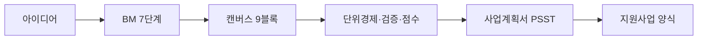

### 2. BM 7단계와 판정 분기
7단계 스코어를 blocking 조건과 80/60/40 구간으로 나누고, 낮은 구간은 6단계 검증으로 돌아갑니다.

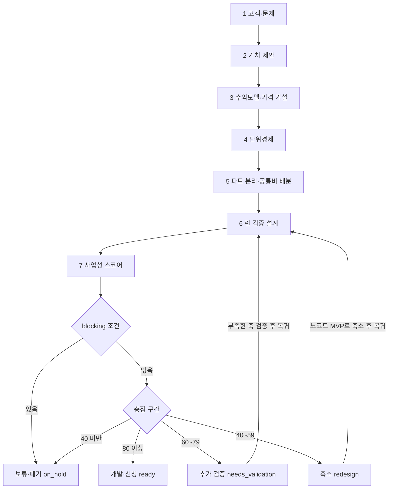

### 3. 비즈니스 모델 캔버스 구조
캔버스 9블록의 표준 배치입니다. 블록마다 답할 질문을 함께 적었습니다. 작성 양식은 [`canvas/BMC_TEMPLATE.md`](canvas/BMC_TEMPLATE.md)에 있습니다.

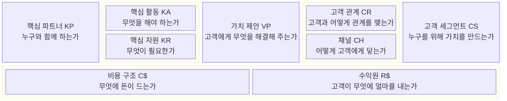

블록끼리 이어지는 흐름입니다. 왼쪽 블록(파트너·활동·자원)은 비용을 만들고, 오른쪽 블록(채널·관계·고객)은 수익을 만듭니다. 둘의 차이는 4단계 단위경제로 검증합니다. 작성 순서는 템플릿 3장을 따릅니다. 고객 세그먼트와 가치 제안을 먼저 쓰고, 수익원과 비용 구조를 이어서 쓴 다음, 나머지 블록을 채웁니다.

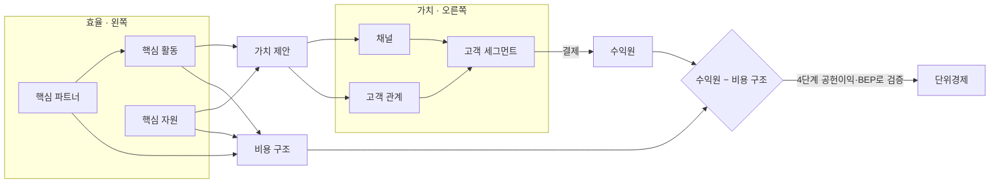

### 4. 7단계와 캔버스 9블록 대응
BM 7단계 각 단계의 산출물이 비즈니스 모델 캔버스의 어느 블록을 채우는지 보여줍니다.

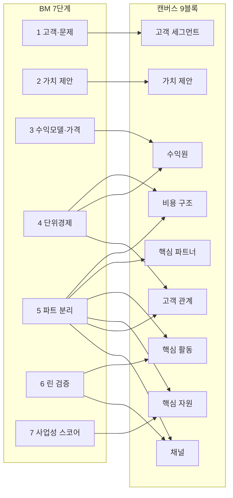

### 5. 캔버스·7단계와 PSST 사업계획서 목차 대응
사업계획서 PSST 네 항목에 어떤 캔버스 블록과 단계 데이터가 들어가는지 보여줍니다. 실제 목차는 공고별로 확인합니다.

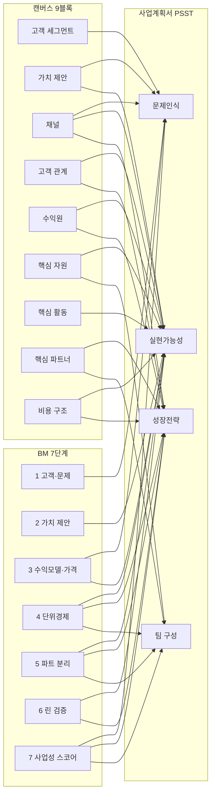

### 6. 증거 등급에서 사업계획서 근거 문장까지
증거 등급 A~E가 점수와 판정을 거쳐 사업계획서 근거 문장이 되는 경로입니다. E 등급은 채점하지 않고 가정으로만 표기합니다.

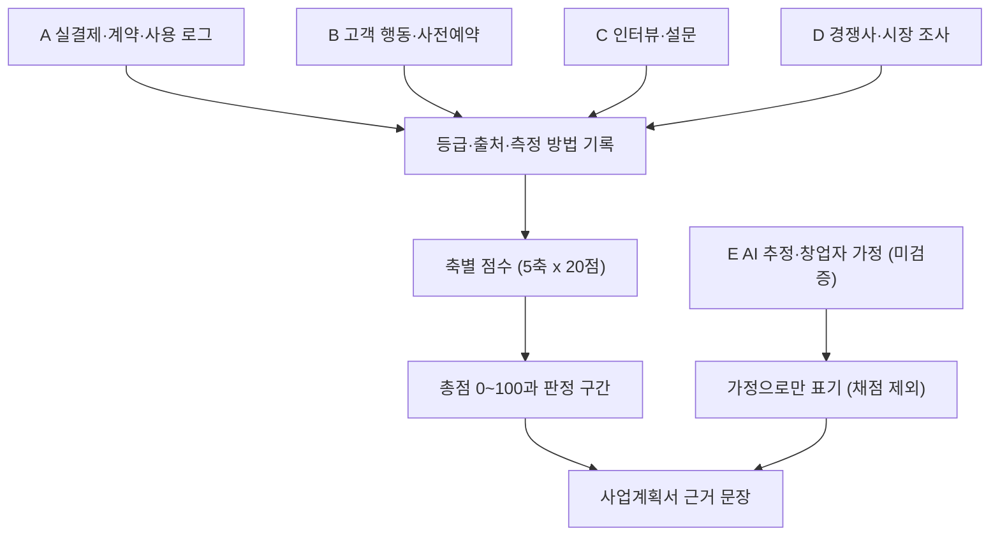

### 7. 단위경제 계산 흐름
ARPU에서 공헌이익을 거쳐 LTV, CAC 상한, 회수 기간, 손익분기와 월 영업손익까지 이어지는 계산 순서입니다.

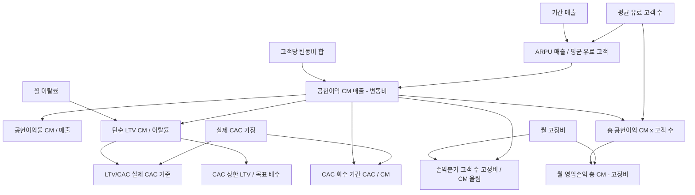

### 8. 사업성 평가 상태 전이
스코어카드가 draft에서 시작해 점수와 blocking 조건에 따라 보류, 재평가, 승인 경로로 이동하는 상태 흐름입니다.

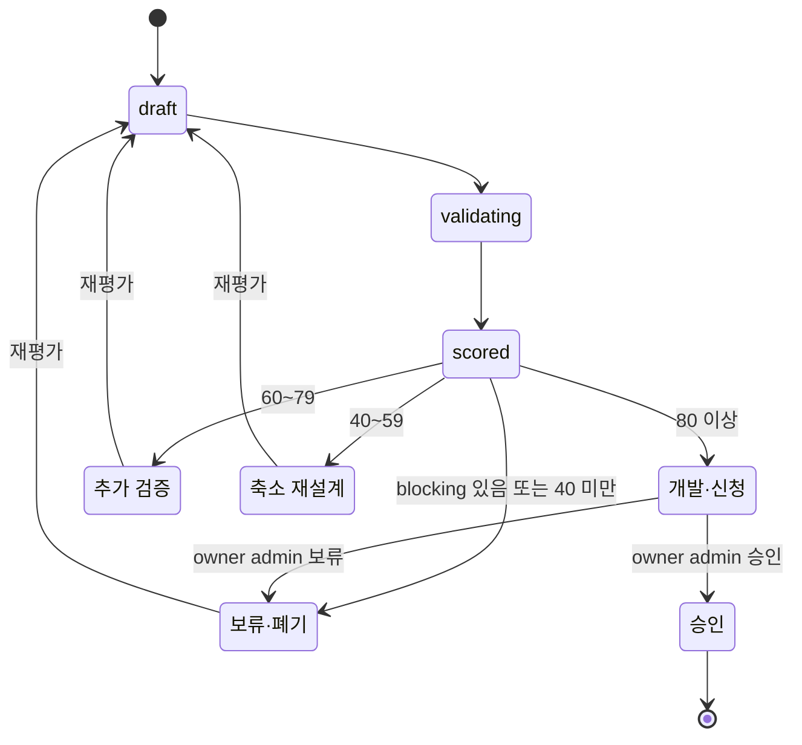

### 9. 데이터 구조
프로젝트, 캔버스, 가설, 증거, 점수, 보고서(사업계획서 출력) 테이블의 관계입니다. 05_DATA_MODEL.md 1절 요약을 따릅니다.

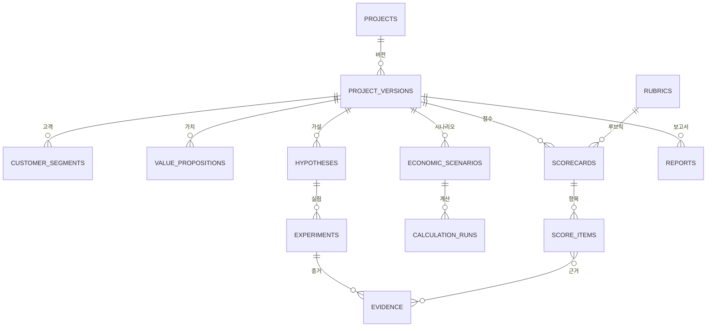

### 10. 레포 관계
BM-CORE, platform-docs, nomad-agent-os가 맡는 역할과 연결 지점입니다.

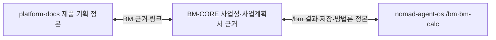

## 연관 저장소

| 레포 | 역할 |
|---|---|
| [platform-docs](https://github.com/DevOps0906/platform-docs) | 제품 기획 정본, 가격 플랜(`Price_Plans/`). 2026-11-11 BM 문서를 이 저장소로 옮김 |
| [nomad-agent-os](https://github.com/DevOps0906/nomad-agent-os) | `/bm` 명령, `bm-model` 스킬, `bm-calc` 계산기 |
